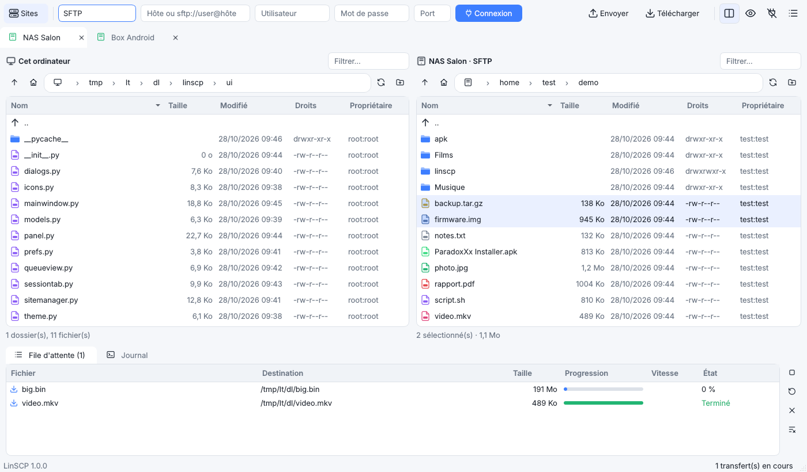
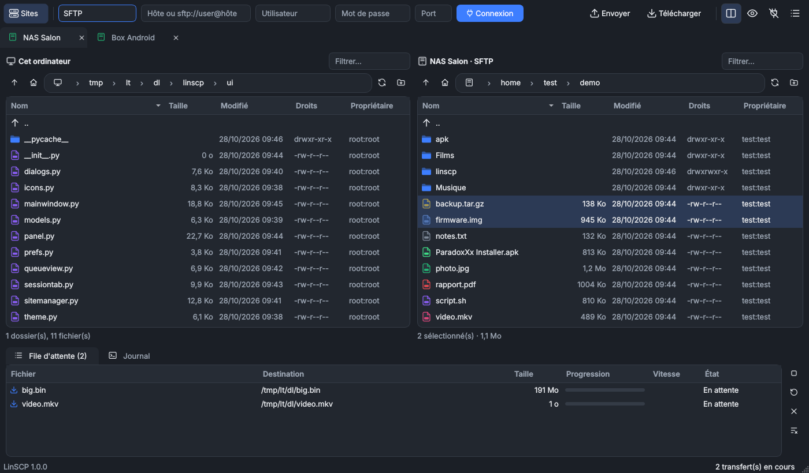

# LinSCP

**🇫🇷 Client SFTP / SCP / FTP / FTPS natif pour Linux, inspiré de WinSCP.**
**🇬🇧 Native SFTP / SCP / FTP / FTPS client for Linux, inspired by WinSCP.**



---

## 🇫🇷 Français

LinSCP n'est **pas** WinSCP sous Wine : c'est une réécriture complète en Python + Qt 6. Elle garde l'essentiel de WinSCP et laisse de côté le superflu.

### Fonctions
- **Protocoles** : SFTP, SCP (y compris les serveurs Dropbear/BusyBox sans SFTP : box Android, routeurs), FTP, FTPS explicite et implicite
- **Interface** : double panneau (local + distant) ou panneau simple, au choix (`Ctrl+D`)
- **Gestionnaire de sites** : mots de passe rangés dans le trousseau du système (GNOME Keyring / KWallet), authentification par clé SSH ou agent
- **File de transferts** : transferts en parallèle (1 à 6), progression, vitesse, temps restant, annulation, relance, **reprise** des transferts interrompus (SFTP / FTP)
- Envoi et téléchargement de dossiers entiers, glisser-déposer entre les panneaux et depuis Nemo / Nautilus / Dolphin
- Fil d'Ariane cliquable, filtre rapide, fichiers cachés, permissions (chmod, récursif), renommer, supprimer, nouveau dossier
- Vérification des clés d'hôte SSH et des certificats TLS (confiance au premier usage, alerte si l'empreinte change)
- Thème clair / sombre / système, icônes redessinées, interface FR / EN
- Connexion rapide : `sftp://user@hôte:port/dossier` dans la barre, ou `linscp sftp://…` en ligne de commande

### Installation (Linux Mint 21+ / Ubuntu 22.04+ / Debian 12+)
```bash
sudo apt install ./linscp_1.0.0_all.deb
```
Les dépendances (`python3-pyqt6`, `python3-pyqt6.qtsvg`, `python3-paramiko`, `python3-keyring`) sont installées automatiquement.

### Raccourcis
| Touche | Action |
|---|---|
| `F5` | Transférer la sélection vers l'autre panneau |
| `F2` | Renommer |
| `F7` | Nouveau dossier |
| `Suppr` / `F8` | Supprimer |
| `Ctrl+R` | Actualiser |
| `Retour arrière` | Dossier parent |
| `Ctrl+L` | Saisir un chemin |
| `Ctrl+H` | Fichiers cachés |
| `Ctrl+N` | Gestionnaire de sites |
| `Ctrl+D` | Double panneau / panneau simple |
| `Ctrl+W` | Fermer la session |

### Fichiers de configuration
`~/.config/linscp/` : `settings.json`, `sites.json` (sans mot de passe), `known_hosts`, `known_certs.json`.

---

## 🇬🇧 English

LinSCP is **not** WinSCP running in Wine: it is a from-scratch rewrite in Python + Qt 6 that keeps WinSCP's essentials and drops the clutter.

### Features
- **Protocols**: SFTP, SCP (including Dropbear/BusyBox servers without SFTP: Android boxes, routers), FTP, explicit and implicit FTPS
- **Layout**: dual pane (local + remote) or single pane (`Ctrl+D`)
- **Site manager**: passwords stored in the system keyring (GNOME Keyring / KWallet), SSH key or agent authentication
- **Transfer queue**: parallel transfers (1–6), progress, speed, ETA, cancel, retry, **resume** of interrupted transfers (SFTP / FTP)
- Whole-folder upload/download, drag and drop between panes and from Nemo / Nautilus / Dolphin
- Clickable breadcrumb, quick filter, hidden files, permissions (recursive chmod), rename, delete, new folder
- SSH host-key and TLS certificate checks (trust on first use, warning when the fingerprint changes)
- Light / dark / system theme, redesigned icons, FR / EN interface
- Quick connect: `sftp://user@host:port/dir` in the bar, or `linscp sftp://…` from the command line

### Install (Linux Mint 21+ / Ubuntu 22.04+ / Debian 12+)
```bash
sudo apt install ./linscp_1.0.0_all.deb
```

### Build the package
```bash
./packaging/build_deb.sh     # → dist/linscp_<version>_all.deb
```

### Run from source
```bash
sudo apt install python3-pyqt6 python3-pyqt6.qtsvg python3-paramiko python3-keyring
python3 -m linscp
```

---



GPL-3.0 · © ParadoxXx Squad · LinSCP is not affiliated with the WinSCP project.
